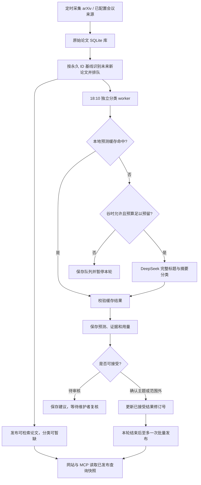

# Paper Compass 新增论文 API 分类规则与运行策略归档

归档日期：2026-11-19，北京时间（UTC+8）。本报告面向项目维护者，不加入网站公开用户文档白名单。

本报告记录当前本地工作区已经实现、测试通过的最终策略：**历史论文不自动重分类；未来新入库论文使用 DeepSeek Flash，根据完整标题和摘要单主题分类；每天预算 3 元；只在允许的谷时窗口发起付费请求；处理不完保存进度，留到下一次任务继续。**

这是代码与配置的归档，不是新的付费压测，也不代表服务器已经启用该策略。此次没有部署服务器、启动模型任务或重分类历史库。归档时相关实现尚在未提交工作区，不能仅凭 Git HEAD 还原；具体源码指纹、实际生效的非敏感配置和验证日志随报告保存。

## 1. 归档内容与证据

| 文件 | 内容 |
| --- | --- |
| [policy.json](policy.json) | 规则、调度、预算、资源限制与部署状态的结构化快照 |
| [configuration.json](configuration.json) | 本地生效的非敏感分类配置、缓存策略哈希、提示词哈希；不包含密钥 |
| [system_prompt.txt](system_prompt.txt) | 运行时实际发送的系统提示词，包含 14 主题和精简输出协议 |
| [provider_pricing.json](provider_pricing.json) | 官方价格及时间规则的核验摘要、链接与核验日期 |
| [cost_projection.json](cost_projection.json) | 基于既有 10 篇实测的日常费用、时长及预算容量外推 |
| [source_fingerprints.json](source_fingerprints.json) | 归档时源码、测试和部署模板的 SHA-256；不是源码副本 |
| [schedules/](schedules/) | 归档时三类任务的 systemd service/timer 模板副本 |
| [validation/pytest-backend.txt](validation/pytest-backend.txt) | 上一轮完整后端回归原始输出：644 passed |
| [validation/pytest-targeted.txt](validation/pytest-targeted.txt) | 上一轮分类、配置和更新专项验证原始输出：154 passed |
| [validation/archive-validation.json](validation/archive-validation.json) | 归档链接、配置一致性、指纹、敏感信息和公开文档白名单检查结果 |
| [SHA256SUMS](SHA256SUMS) | 本归档附件的完整性校验清单 |

旧报告保持原样：[11 月 18 日真实 API 实测](../2026-11-18-deepseek-classification-benchmark/README.md)、[11 月 19 日服务器增量统计](../2026-11-19-server-paper-growth/README.md)。它们记录的旧预算和批量上限是当时事实；**当前执行配置以本报告为准**。持续维护的操作说明另见 [API 分类维护手册](../../admin/api_classification.md)。

## 2. 最终配置一览

| 项目 | 当前规则 |
| --- | --- |
| 分类策略 | 本地已配置 `api`；发行模板仍默认 `keywords`，避免升级后意外付费 |
| 提供商 / 模型别名 | DeepSeek 官方 / `deepseek-flash` |
| 分类版本 | `api-single-topic-v2` |
| 输入 | 完整标题 + 完整摘要，每次一篇 |
| 输出 | 一个主主题，或明确进入待审核 / 范围外状态 |
| 思考 | `reasoning_effort=none`；不启用思考模式 |
| 输出格式 / temperature | JSON object / 0 |
| 输出上限 | 512 Token；不是每篇实际输出量 |
| 请求并发 | 1，串行 |
| 每轮篇数 | `0`，表示不限总篇数，持续处理当前可执行队列 |
| 每批队列读取 | 最多 100 条轻量记录；逐篇读取完整文本 |
| 每日费用预算 | 3 元，按北京时间自然日累计，不结转余额 |
| 每日请求数 / Token 数 | 默认 `-1`，不另设数量上限，金额约束仍有效 |
| 每日分类启动 | 北京时间 18:10，一天一次 |
| 谷时约束 | 每次付费请求前检查；手动命令与定时任务均适用 |
| 暂停处理 | 保存已完成结果和未完成队列，不回滚成功项 |
| 历史库 | 按首次启用时的论文 ID 基线冻结，不自动补分类 |
| 关键词逻辑 | 保留为维护者手动备用方案；API 失败不自动切换 |
| 目标服务器 | 2 vCPU / 2 GiB；不新增模型常驻进程、Redis 或向量数据库 |

“不限篇数”不等于“必定当天全部完成”：谷时、金额、熔断、任务时限和缺失元数据都可能导致延期。

## 3. 采集、分类与网站的数据流



采集与分类分离。`update` 抓取、写原始库、排队和发布，不调用模型；模型问题通常不会使新论文停止入库。排队阶段报错会记录失败并尝试继续发布可检索候选；历史基线初始化、原始库备份等基础步骤失败则可能在采集前退出，不属于模型故障。

分类 API 只接收标题和摘要，不发送作者、会议名称、论文 ID、用户收藏或行为记录；不下载或读取 PDF，不使用网页检索，也不执行文本中的指令。分类阶段不修改原始论文库结构或论文内容。采集器正常写入新论文、补充元数据属于采集职责。

API 模式下 arXiv 候选不再经过原关键词预过滤，但仍只抓配置中的类别和时间窗口；这不等于 arXiv 全站全量抓取。已配置会议来源按现有适配器运行。OpenAlex 不在默认更新阶段启用，显式启用时仍受其上游检索词限制。

## 4. 分类时间与谷时规则

### 4.1 当前源码中的每日调度

以下是本地部署模板，不是此次重新核验的服务器实际配置。

| 任务 | 北京时间 | 命令 / 作用 |
| --- | --- | --- |
| 会议增量检查 | 06:30 | `update --scope conferences` |
| arXiv 更新 | 14:00 | `update --scope arxiv`；RSS 后再做 API 补漏 |
| API 分类 | 18:10 | `classify-papers --queued-only --publish` |

三者均使用 `Asia/Shanghai` 和 systemd 日历定时器。此前讨论过的 04:00 不是当前模板的 arXiv 时间。实际部署后应以 `systemctl list-timers` 和服务器安装的 unit 文件为准。

分类 timer 设置 `Persistent=true`，关机错过触发后可能补跑；补跑仍接受请求前的谷时限制。启动条件要求 `PAPER_COMPASS_CLASSIFIER=api`，并且 arXiv / 会议采集服务没有处于 active、activating 或 deactivating。若启动条件不满足，则跳过本次，不另建补跑计时器。

### 4.2 官方价格时段与本项目允许窗口

价格和时段于 2026-11-19 核验，依据 [DeepSeek 官方价格说明](https://api-docs.deepseek.com/zh-cn/quick_start/pricing/)。官方规则中，周一至周五非中国法定节假日的 09:00–12:00、14:00–18:00 为高峰，其余时间、周末和法定节假日为谷时。

本项目不新增节假日日历依赖，采用更保守的固定规则：

| 日期 | 可发起请求的谷时区间 | 禁止发起请求的区间 |
| --- | --- | --- |
| 周一至周五，即使当天是法定节假日 | 00:00–09:00、12:00–14:00、18:00–24:00 | 09:00–12:00、14:00–18:00 |
| 周六、周日 | 全天 | 无固定高峰禁用区间 |

区间按左闭右开理解；还要扣除下面的请求安全余量。节假日不扩展窗口可能少利用折扣时间，但不会因为猜错假期而调用高峰接口。

### 4.3 每个请求前的检查与临界点

时间检查位于 `ResultStore.reserve()`，在 SQLite 写锁取得后读取当前时钟，避免等待锁之前的旧时间被误用。检查不依赖操作系统的显示时区，统一换算为北京时间。

默认提前余量为：`单请求读取超时 60 秒 + 15 秒 = 75 秒`。在 08:58:45 或 13:58:45 起，默认配置已不再启动可能触及下一高峰的新请求；改变读取超时也会改变余量。

已有请求正常结束，不强行取消，以保留已付费的结果。这是发起请求前的保守检查，不是对网络请求总墙钟时间的绝对保证；连接超时为 10 秒、读取超时为 60 秒，异常、丢响应仍按费用预留处理。

到达高峰或提前余量时，worker 写入 `deferred_reason=off_peak_window`、`resume_at`，该任务返回 pending，不消耗失败重试次数，然后结束本轮。纯本地预测缓存命中不发 API，可在高峰复用。

**`resume_at` 是最早允许重试的时间，不是新的自动触发时间。** 例如上午暂停后最早可能在 12:00 重试，但默认只有 18:10 的每日 timer；自动继续要等下一次 timer，也可以由维护者在谷时手动启动。预算暂停同理：次日零点恢复额度，不会零点自动启动分类。

## 5. 模型价格、用量与每日预算

### 5.1 价格快照

单位为人民币 / 百万 Token。项目当前只使用谷时单价，高峰价格仅供核对。[官方来源](https://api-docs.deepseek.com/zh-cn/quick_start/pricing/)

| Token 类型 | 谷时单价 | 高峰单价 |
| --- | ---: | ---: |
| 输入缓存未命中 | 1.00 | 2.00 |
| 输入缓存命中 | 0.02 | 0.04 |
| 输出 | 4.00 | 8.00 |

`deepseek-flash` 是请求别名；官网当时列出的版本为 `DeepSeek-V4.1-Flash-1017`。官网版本不是本项目对实际响应模型版本的独立取证，别名和价格以后可能调整。

### 5.2 费用公式与请求前预留

```text
单次估算费用（元） =
  [(输入 Token - 缓存命中 Token) × 输入单价
   + 缓存命中 Token × 缓存输入单价
   + 输出 Token × 输出单价] / 1,000,000
```

SQLite 内部以微元记账：1 元 = 1,000,000 微元；每次费用向上取整到 1 微元。

在请求发出前：

1. 校验配置、输入与请求窗口，检查持久熔断状态。
2. 在同一事务中计算当天所有请求的已记账 / 预留金额与 Token。
3. 估算输入上界：序列化整个请求的 UTF-8 字节数，加 256 余量；这不是精确 tokenizer 结果。
4. 输入先按全部未命中计价，输出按最多 512 Token 预留；不提前假定提供商缓存命中。
5. 只有剩余额度足以覆盖下一次预留，才登记请求并发出 HTTP。

因此达到预算前可能还剩几分甚至更多余额，却已不能预留下一篇，提前暂停是预期行为。

收到合法 `usage` 后，使用请求时保存的价格，按实际输入、缓存命中、输出结算。缺失或不可信用量、超时、进程退出时保留保守预留；格式错误的回复也可能已消耗 Token，不能当免费请求。实际用量超过预留时会熔断后续请求。

### 5.3 每日 3 元的确切含义

预算日期以请求登记时的北京时间自然日为准。自动 worker、人工数据库分类和 JSON 样本测试共用同一运行目录下的账本；多次启动不能重置当日费用。跨午夜属于两个自然日；同一次长任务也可能分别使用两天的额度。不同运行目录有不同账本，不会自动合并同一密钥在外部程序产生的费用。

未用额度不滚存。金额设为 0 禁止新请求；请求数 / Token 数设为 `-1` 表示该项不限，设为 0 则禁止新请求。默认取消每轮 200 篇和日 500 请求 / 100 万 Token 这类数量上限，但金额和谷时约束仍有效。

这是按配置价格和响应用量控制的程序预算，不是提供商扣款的绝对保证；调价、配置错误、未知用量或同一密钥的其他消费者仍要结合提供商账单检查。按 30 个自然日计算，预算规划为最多约 90 元；31 天则约 93 元，不表示一定花满。

## 6. 近期规模、Token 与费用预期

以下沿用既有报告的实测数据，没有在本次归档重新调用模型。

| 11 月 18 日的 10 篇真实样本 | 合计 | 单篇平均 |
| --- | ---: | ---: |
| 输入 Token | 19,231 | 1,923.1 |
| 其中输入缓存命中 | 13,824 | 1,382.4 |
| 输入缓存未命中 | 5,407 | 540.7 |
| 输出 Token | 864 | 86.4 |
| 总 Token | 20,095 | 2,009.5 |
| 单篇处理时间 | 11.326 秒 | 1.1326 秒 |

该样本按谷价折算每篇约 0.000913948 元；如果提供商输入缓存完全失效，同样 Token 规模每篇约 0.0022687 元。前者是观测条件外推，后者是无输入缓存情景；都不包含失败重试和未来文本长度变化。

| 待处理论文数 | 按原样本缓存条件所需费用 | 全部输入未命中所需费用 | 连续分类处理时间 |
| --- | ---: | ---: | ---: |
| 876 | 约 0.80 元 | 约 1.99 元 | 约 16.5 分钟 |
| 1,146 | 约 1.05 元 | 约 2.60 元 | 约 21.6 分钟 |
| 2,000 | 约 1.83 元 | 约 4.54 元 | 约 37.8 分钟 |
| 3,000 | 约 2.74 元 | 约 6.81 元 | 约 56.6 分钟 |

表中是完成整批的需求估算，不是承诺会放行超过 3 元的任务；超出日预算的部分会延期。数字与未四舍五入结果见 [cost_projection.json](cost_projection.json)。

在上述假设下，3 元约对应 3,282 篇（沿用样本缓存）或 1,322 篇（全部输入未命中）的理论费用容量；请求前保守预留可能进一步提前停止。10 篇不是大规模吞吐或分类准确率测试。

服务器现存记录中，排除 11 月 12 日首次补漏后，11 月 13–18 日原始库新增 3,505 条：有新增的四天平均 876.25 条，最大 1,146 条；包含零增量日的自然日平均 584.17 条。启用 API 模式扩大候选范围后可能更多，不能把历史数量当固定的未来任务量。

## 7. 单主题分类规则

### 7.1 判断对象与 14 个主题

这套实现由 LLM 直接理解文本并输出受约束的分类，不是标题关键词计数，也不是新增的向量模型或多标签分类器。主要贡献决定主主题，研究中使用了什么工具、引用了什么背景，不直接决定归属。

| topic_key | 主题 | 主要边界 |
| --- | --- | --- |
| `llm` | 大模型（LLM） | 研究大语言模型本身；普通小模型、仅把 LLM 当工具的工作不自动归入 |
| `agents` | AI Agent | 规划、记忆、工具调用、多智能体和长时交互执行，区别于普通问答 |
| `ai_infra` | AI Infra | 训练、推理、部署的系统贡献；仅声称模型更快不足以归入 |
| `reasoning_post_training` | 推理与后训练 | reasoning、测试时计算、后训练与偏好优化；inference 执行系统通常归 AI Infra |
| `multimodal_generative` | 多模态与生成模型 | 跨模态理解与生成建模；一般视觉感知、几何或渲染另行判断 |
| `ai_safety_alignment` | AI 安全与对齐 | AI 安全、可靠、隐私、攻防、遗忘、解释；几何或序列 alignment 不等于安全对齐 |
| `data_evaluation` | 数据与评测 | 数据集、数据方法或评测体系必须是主要贡献，使用已有基准不算 |
| `embodied_robotics` | 具身智能与机器人 | 以物理环境中的感知、行动、交互为目标，而不是只借机器人验证通用算法 |
| `reinforcement_learning` | 强化学习与决策 | 通用 RL 与序列决策；围绕语言模型后训练的 RL 优先后训练主题 |
| `ai_for_science` | AI for Science | 主要目标是具体科学、医学或工程问题，不是只使用科学数据 |
| `vision_graphics` | 视觉与图形 | 视觉感知、图像处理、三维几何与图形；使用 VLM 不自动改归多模态 |
| `ml_foundations` | 机器学习基础 | 通用理论与方法；不是无法判断时的默认收纳类 |
| `language_speech_retrieval` | 语言、语音与检索 | 主要贡献是语言、语音或检索任务，即使用 LLM 也可能归入这里 |
| `systems_architecture` | 系统与计算架构 | 通用系统与体系结构；以 AI 工作负载为核心的系统贡献优先 AI Infra |

交叉研究以“主要推进了哪个领域”选择一个主题。例如新安全数据集若主要交付物是数据或评测体系，应选数据与评测；新安全算法则按其核心目标归安全。完整边界以归档的 [system_prompt.txt](system_prompt.txt) 为准。

**单主题规则针对未来新接受的 API 结果，不强行重写历史多主题标签。** 因而网站整体仍可能存在旧论文属于多个方向的情况。

### 7.2 输入、输出与本地校验

文本优先取 `abstract`，为空时取 `summary`；不会拼接两份重复摘要。缺标题、缺摘要或命中已知“暂无摘要”占位符时不请求；标题和摘要合计超过 60,000 字符时不截断，进入无效输入处理。

实际模型回复示例：

```json
{"papers":[{"index":1,"decision":"classified","topic_key":"ai_infra","confidence":"high","reason":"主要贡献是面向大模型推理的调度与缓存系统。","evidence":"a serving system that schedules GPU workloads"}]}
```

模型不复述标题、摘要或中文主题名，本地在校验后补回原文和主题名。字段必须严格符合单篇协议：papers 只有一项，index 必须是整数 1，topic_key 必须合法，不接受额外字段；标题摘要作为数据，不执行其内嵌指令。

响应内容超过 1,000,000 字节会被拒绝解析；这是收到响应后的校验，不是网络层限制下载到同样大小。HTTPS 请求禁止自动跟随重定向；端点不允许在 URL 中夹带用户名、密码、查询参数或片段，凭据只放授权头。

| 决定 | 主题与信心规则 | 发布行为 |
| --- | --- | --- |
| `classified` | 一个合法主题，信心 high / medium | 更新该论文的单主题归属 |
| `needs_review` | 最可能主题或 null；low 必须进入此状态，重要歧义也应进入 | 保存建议，不自动接受新标签 |
| `out_of_scope` | 主题必须为 null，不能用 low 冒充确定排除 | 仍保留可检索论文，不强塞主题 |

confidence 是模型定性自评，不是质量分、可信度或经过统计校准的概率。reason 的提示词目标为 30–80 字，本地硬校验是非空且不超过 500 字符。evidence 的提示词目标是不超过 40 个英文单词，本地硬校验是非空、最多 2,000 字符、必须为标题或摘要中的连续原文；并没有额外的 40 单词计数器。只有 needs_review 可以没有 evidence。

结构与原文证据校验能阻止格式错误或伪造引文，不能代替真实分类准确率评测。

## 8. 历史边界、变更与缓存

### 8.1 永久身份基线

首次 API 更新在抓取写入前执行 `prepare_scope()`；也可以显式运行 `classification-baseline`。它只读取当时原始库 ID，在旁路库记录 `historical`、原始库规范路径、时间和数量。已有基线不重建；不同原始库不得共用这一份基线。

之后首次出现的 ID 记作 `new`，才进入自动分类。判断不依赖论文发表日期，所以今天新抓到的旧论文也可以是“新入库”；相同身份再次抓到则不是新论文。`demo_topic` 示例数据不加入常规分类队列。

| 事件 | 默认行为 |
| --- | --- |
| 基线内历史论文无变化 | 不排队、不付费重分类 |
| 历史论文补摘要、作者或修改标题 | 不付费重分类；发布时保留上一查询快照的标签 |
| 历史中原本未展示的条目发生变化 | 不因启用 API 而自动扩大其历史可见性 |
| 新 ID 缺摘要 | 保存等待状态，待文本补全后重新排队 |
| 未来新论文的标题 / 摘要再次变化 | 原文本结果不能贴给新文本，可重新分类 |
| 只更换模型、提示词或思考设置 | 不自动重分已经完成且文本未变的论文 |
| 显式 `--all-papers` | 允许维护者主动处理历史，可能产生较大费用 |

初始化时，历史中尚未完成的任务会标记 historical，预测和已接受结果保留。被显式放行的历史手动任务标为 manual，未完成部分需要继续用 `--all-papers`，默认自动 worker 不续跑这类历史任务。人工确认同文本的结果也不会被常规排队覆盖。

历史标签依赖已有正常查询快照；若历史存在但查询快照缺失，API 发布会明确拒绝，不能静默把历史隐藏或清空。原始论文库、用户收藏引用和公开论文标识保持兼容。

基线绑定原始库的规范路径，不应把本地运行目录中的基线直接拷到路径不同的服务器。部署时保留服务器自己的分类账本，在对应服务器环境初始化；不要为了通过路径校验而删除既有账本。历史标签保留后仍接受正常的期刊展示范围等过滤规则。

### 8.2 两类缓存与版本一致性

本地完整预测缓存命中：同样文本与策略直接复用，不发请求、不产生本次调用费用。提供商输入缓存命中：仍然有一次 API 请求，只是部分输入 Token 按较低单价收费，两者不能混为一谈。

预测 key 包含完整文本和策略哈希；策略包含分类版本、端点、模型别名、实际系统提示词、temperature 与 reasoning_effort。API Key、价格、预算、超时和输出 Token 上限不在该策略 key 中。相同文本在不同来源 ID 下可以共享预测；用户密钥不写入哈希或缓存内容。

发布结果还必须匹配当前标题摘要的文本哈希。若 HTTP 期间新文本已入队，旧响应只能存入旧文本缓存，不能覆盖新任务；同一 ID 每轮至多尝试一次，避免反复变化使本轮无限处理。

本地输出中的 request_id 是项目账本 UUID，不是提供商服务端请求 ID。缓存中历史 usage 也不是本次新增消耗，必须按 requests 账本汇总。

## 9. 状态、重试、暂停与审核

| 状态 | 含义与后续 |
| --- | --- |
| `pending` | 等待执行；预算或窗口暂停仍保留为此状态并写下次可尝试时间 |
| `running` | 当前尝试已经领取，有租约 |
| `retry_wait` | 网络、限流、格式错误等暂时失败，等待退避或熔断到期 |
| `waiting_metadata` | 缺标题 / 摘要，等待文本变化，不反复付费重试 |
| `invalid_input` | 例如文本超长，等待修正或显式恢复 |
| `needs_review` | 需要维护者复核，默认不重复询问模型 |
| `classified` | 接受一个主题，可发布 |
| `out_of_scope` | 接受无主题决定，论文仍可检索 |
| `failed` | 自动尝试达到上限，须维护者显式恢复 |
| `historical` | 旧任务冻结，不进入默认自动 worker |

每篇失败最多自动尝试 3 次：第 1 次失败后退避 5 分钟，第 2 次失败后退避 10 分钟，第 3 次失败即进入 failed；不会再自动等待 20 分钟后尝试第 4 次。退避时间是最早允许时间，不意味着有另一个定时器准时启动。

每次处理至多一次 HTTP，不做隐藏收费重试。同轮连续 3 次暂时错误会熔断 15 分钟；鉴权、计费或其他不可重试 HTTP 错误（如 400、401、402、403、404，重定向也不跟随）会停止本轮并熔断 1 小时。429 和 5xx 为暂时错误，错误 JSON / 不完整输出也不直接发布。

领取租约为 `读取超时 + 60 秒`，默认 120 秒。进程异常退出后，下次处理过期租约；已达 3 次尝试则转 failed，否则可恢复。预算、窗口或熔断检查阻止了真实请求时，不额外消耗失败次数。

队列只选择已到执行时间的 pending / retry_wait，按 `next_attempt, last_attempt, paper_id` 排序，不是按发表日期或严格 FIFO。若新增长期超过费用与吞吐容量，队列可能积压，需要观察 pending_new，而不能只看最近任务退出成功。

人工审核可确认主题、纠正为其他主题或标记范围外，须留说明，并提供或复用有效原文证据。保存独立人工修订，不改写原模型预测；正文变化后不能直接审核旧文本版本。待审核建议最多显示前 20 项，不代表数据库中只保存 20 项。

## 10. 数据存储、发布与资源限制

| 数据 | 位置 / 作用 |
| --- | --- |
| 原始论文 | 配置中的 `database.history_path`，通常为 `matched_entries_history.db` |
| 分类旁路库 | `$PAPER_FIREHOSE_DATA_DIR/classification/api.db`，SQLite WAL |
| `tracked_papers` | historical / new / manual 身份范围 |
| `jobs` | 任务状态、尝试数、退避时间、租约、文本和缓存 key |
| `predictions` | 模型预测与独立人工修订缓存、证据及模型用量 |
| `assignments` | 已接受且与当前文本匹配的结果引用 |
| `requests` | 每次真实 API 请求的预留、结算、价格、日期与用量 |
| `state` | 基线、已接受修订号、熔断到期时间 |
| 本轮临时 `worker_seen` | 限制同一 ID 每轮只处理一次，连接关闭即消失 |
| 查询库 | `query-store/query-*.db` 与原子切换的 `current.json` |
| 分类状态 | `classification/status.json` |
| 采集状态 | `update-status.json` 和对应 arxiv / conferences 文件 |

`--queued-only` 的任务领取不扫描原始全库：分批取得队列，再逐篇只读查文本；HTTP 期间不保留原始库读事务。省略该选项的人工命令、采集后的排队对账仍会扫描原始库 ID / 文本。

分类任务结束时，已接受修订号变化才至多触发一次查询库构建；没有新接受决定就跳过。待审核不会直接发布新标签。发布失败保留旧查询库与已保存的分类，下次可重试。

查询库发布不是原地改线上唯一文件，也不是“完全没有全量工作”：构建会复制原始库快照、复制之前查询库、扫描原始行指纹，仅转换并更新变化条目，再原子切换清单。当前用户请求继续读已有快照；聚合统计离线计算。Web 与 MCP 不在用户请求里调用分类模型。

| 分类 service 限制 | 当前模板值 |
| --- | --- |
| CPUQuota | 50% |
| MemoryHigh / MemoryMax | 256M / 384M |
| TimeoutStartSec | 6h |
| Restart | no，不自动重启收费任务 |
| Nice | 15 |
| I/O 调度 | best-effort，优先级 7 |
| SQLite 页缓存 | 分类读写约 4 MiB；发布读分类约 2 MiB |

这些是资源限制与局部缓存配置，不是整个任务内存占用、完成时间或零卡顿的保证；云盘与构建阶段仍需实际监测。分类与采集的启动避让也不是跨服务的全程互斥；后续采集仍可能在长分类运行中启动，SQLite 事务与发布锁负责一致性。

## 11. 配置、命令与部署核对

所有业务配置集中在根目录 `.env`；显式 CLI 参数优先于环境同项，进程环境优先于文件，文件优先于代码默认。`.env` 不提交，不能被本报告、网站静态文件或发布包收录。当前安全配置快照仅保留分类非敏感字段。

```ini
PAPER_COMPASS_CLASSIFIER=api
# 密钥仅填入私有 .env，不写入报告
PAPER_COMPASS_CLASSIFICATION_BASE_URL=https://api.deepseek.com
PAPER_COMPASS_CLASSIFICATION_MODEL=deepseek-flash
PAPER_COMPASS_CLASSIFICATION_REASONING_EFFORT=none
PAPER_COMPASS_CLASSIFICATION_TIMEOUT=60
PAPER_COMPASS_CLASSIFICATION_MAX_TOKENS=512
PAPER_COMPASS_CLASSIFICATION_LIMIT=0
PAPER_COMPASS_CLASSIFICATION_DAILY_BUDGET_CNY=3
PAPER_COMPASS_CLASSIFICATION_DAILY_REQUEST_LIMIT=-1
PAPER_COMPASS_CLASSIFICATION_DAILY_TOKEN_LIMIT=-1
PAPER_COMPASS_CLASSIFICATION_PRICE_INPUT=1
PAPER_COMPASS_CLASSIFICATION_PRICE_CACHED_INPUT=0.02
PAPER_COMPASS_CLASSIFICATION_PRICE_OUTPUT=4
```

`PAPER_COMPASS_CLASSIFICATION_API_KEY` 是分类专用变量，不复用 GitHub 或其他模型密钥。兼容服务可设置 reasoning_effort=auto 省略参数，但不能据此保证关闭思考；改变提供商或模型必须重新校验单价、时段和协议。本报告的谷时规则针对当前 DeepSeek 配置。

以下命令需在对应部署环境运行，不能把服务器路径拿到本地 WSL 执行。查看状态不发模型请求，但可能创建 / 迁移分类旁路库；不是对整个文件系统无写入的诊断。

| CLI 参数 / 命令 | 行为 |
| --- | --- |
| `classification-baseline` | 建立一次性历史身份基线，无模型调用，写入旁路库 |
| `classify-papers --queued-only` | 只处理已排队任务，不进行全库排队对账 |
| `--limit N` | 数据库任务单轮数量上限；0 为不限，不替代预算与谷时约束 |
| `--publish` | 本轮完成或暂停后尝试批量发布已接受结果；要求 API 模式 |
| `--all-papers` | 显式允许历史任务；不能与 queued-only 同时使用 |
| `--retry-failed` | 显式恢复失败 / 无效或延后任务；仍受谷时和预算保护 |
| `--input / --output` | 成对使用，处理 JSON 样本，不修改原始库和查询快照 |
| `classification-status` | 查看任务分布、当天请求 / Token / 估算费用、基线、熔断和待审核建议 |
| `classification-status --enabled` | 仅检查策略是否为 API，不校验密钥可用性 |
| `classification-status --reset-circuit` | 清除熔断；不重置日预算 |
| `review-classification` | 人工确认或修改分类，结果发布另行完成 |

JSON 样本模式与数据库队列不同：一次读取整份样本，文件最大 16 MiB；CLI 默认 limit=0 时最多 10,000 篇，显式 JSON limit 必须为 0–10,000，直接 Python 函数默认 limit=50。它先验证所有输入，再逐篇调用，已有输出文件绝不覆盖。预算 / 谷时暂停时，未处理项在导出文件中标为 pending，汇总 failed 并返回非零退出码；这不等同于为每条 JSON 输入创建数据库 jobs，重跑应使用新的输出路径并复用预测缓存。

```bash
# 项目根目录；配置与运行目录必须指向同一环境
paper-firehose --config .runtime-demo/config/config.yaml classification-baseline
paper-firehose classification-status

# 会产生模型请求，受谷时和 3 元预算约束
paper-firehose --config .runtime-demo/config/config.yaml classify-papers --queued-only --publish

# 人工审核后，下次分类 worker 也可只做结果发布
paper-firehose --config .runtime-demo/config/config.yaml review-classification \
  --paper '<64位哈希论文ID>' --topic ai_infra --note '人工核对后确认主要贡献。'
```

部署前须保留正常查询快照、原始库与分类旁路库备份，先建立历史基线，再运行 API 采集。将 unit 模板和代码更新到服务器、设置服务器自己的私有 `.env` 后，才安装并启用分类 timer；仅上传源码不会让 timer 自动生效。

在服务器上核对实际安装状态：

```bash
systemctl list-timers --all --no-pager paper-compass-classify.timer
systemctl cat paper-compass-classify.service paper-compass-classify.timer
systemctl status paper-compass-classify.service --no-pager -l
journalctl -u paper-compass-classify.service -n 80 --no-pager
cat /opt/paper-compass/.runtime-demo/classification/status.json
```

`status=batch_complete` 仅表示本轮可执行工作处理结束，仍应查看 pending 和各状态；`deferred` 表示预算 / 窗口等暂停，`partial_failure` 表示失败或发布未完成。UTC 时间字段需转换为 UTC+8 解读。状态命令的 estimated_cny 是账本估算，不是提供商扣费回执。

回滚分类策略时，可停止分类 timer、改回 `PAPER_COMPASS_CLASSIFIER=keywords`，再按维护手册重建查询库；API 不会自动回退。精确恢复旧展示可切回仍保留的查询快照。保留旁路库，尤其不要删基线或账本来“清空重来”；原始论文和用户数据无需迁移。

## 12. 验证状态与后续核验点

归档使用上一轮验证输出：完整后端 644 项通过、2 条上游弃用警告；专项 154 项通过。完整回归排除了浏览器测试，二者用例有重叠，不能加成 798 个不同测试。本轮仅归档与文档更正，没有重新执行付费调用或更改业务代码。

已验证的关键路径包括：超过 200 篇的队列分批处理、历史 ID 和元数据变化隔离、原始库不被分类修改、单主题与证据校验、缓存复用、窗口边界与周末、暂停不耗失败次数、恢复续跑、预算共享与北京时间跨日、租约恢复、人工审核及查询库发布失败保护。

本地验证不代表云端启用。下一次手动部署应确认三个 timer 的实际时间、服务器 `.env` 的策略与价格、历史基线、分类日志和待处理状态，并观察首次实际运行用量。未进行新的全量分类准确率标注、服务器长期吞吐测试或提供商账单对账。

为便于后续分析，至少持续观察：每天新入队数、classified / needs_review / out_of_scope 数、pending_new、失败与暂停原因、真实请求数、输入与输出 Token、提供商缓存命中、预留费用与结算估算。若积压持续增长，应先检查缺摘要、来源变化、错误和日预算，再决定调整策略，不能通过删除队列或基线来掩盖。
