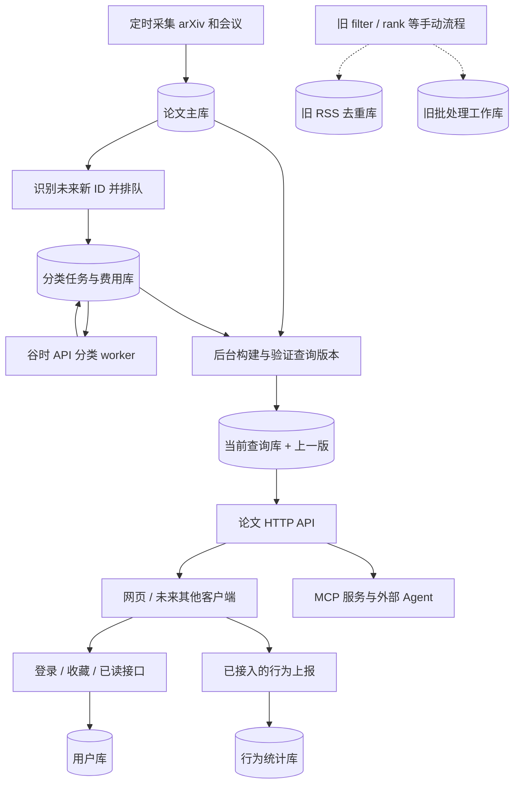

# Paper Compass 数据库架构、规模与运行职责报告

本报告供项目维护者、开发者和接手运维人员阅读。先按“文件柜—工作表—表头”的方式理解：一个 SQLite 文件是数据库，一个数据库里可以有多张表，每张表的列就是字段。本文先说明用途与运行流程，再给出真实大小、行数、结构、备份和恢复注意点；完整字段中文解释放在附件。

## 1. 本次统计范围与证据

- 服务器数据采样：**2026-11-19T11:09:04+08:00 至 2026-11-19T11:09:23+08:00**，北京时间（UTC+8）。索引 / 外键补充采样时间为 2026-11-19T11:13:55+08:00。
- 部署源码提交：`50ed6344d989a38242f7aced252d3e11caac0f9e`；13 个相关运行源码文件已核对，本地与服务器 SHA-256 一致。
- 运行目录：`/opt/paper-compass/.runtime-demo`。虽然名称带 `.runtime-demo`，它现在存放实际生产数据，不能按演示数据目录处理。
- 全部采样为只读结构、页统计和聚合计数，没有导出用户身份、会话凭证、论文内容、事件 details 或 API 密钥；没有执行 VACUUM、分类请求、采集或部署。
- 每个库使用独立只读事务，保证单库采样一致；这不是七个库在同一时刻的跨库原子快照，用户行为计数在报告之后仍可能增长。

| 附件 | 内容 |
| --- | --- |
| [inventory.json](inventory.json) | 文件大小、表行数、页统计、目录占用、备份清单及服务时刻 |
| [schema.json](schema.json) | 所有项目表、搜索虚拟表 / 内部表的 SQL 和字段定义 |
| [indexes_and_constraints.json](indexes_and_constraints.json) | 实际索引、触发器和外键定义，不含数据记录 |
| [fields.md](fields.md) | 23 张业务表、140 个业务字段的完整中文解释 |
| [capacity_summary.json](capacity_summary.json) | 容量汇总及计算口径，数值单位为字节 |
| [source_fingerprints.json](source_fingerprints.json) | 运行源码指纹与部署版本，不包含源码或密钥副本 |
| [validation.json](validation.json) | 统计口径、字段覆盖、链接、表格与敏感信息检查结果 |
| [SHA256SUMS](SHA256SUMS) | 本归档文件校验清单 |

本报告是内部材料，不进入网站公开文档白名单。仅更新本地文档，不改变线上服务或数据库。

## 2. 架构结论

当前是 **Python 服务 + SQLite 文件数据库 + 后台采集 / 分类任务 + 版本化查询库**。项目当前未依赖独立的 MySQL、PostgreSQL、Redis 或向量数据库服务。SQLite 不是一个需要另开端口的服务，而是由 Python 直接读写本机文件。

按用途共 7 类库，其中 5 类支撑当前主要功能：论文主库、查询库、分类库、用户库、行为库。另有旧 RSS 去重库和旧任务工作库保留兼容。当前网页不再从主库加载全部论文构建 Python 内存索引，也不把全库塞进 HTML。

浏览器、小程序或 App 可以通过 HTTP API 取得分页数据；数据库留在服务器。MCP 也走论文 HTTP API，没有额外建立一套 MCP 数据库。

本次只读统计使用 SQLite 3.45.1，七类文件均为 SQLite 数据库格式。字段类型主要为 TEXT、INTEGER、REAL，搜索内部表还使用 BLOB；不是七种不同数据库产品。

网页里的论文查询是只读的；登录、收藏、已读和行为上报会写各自独立的用户 / 行为库。“论文服务只读”不代表网站所有功能都完全不写数据库。

## 3. 当前规模与数据库大小

下表是当前版本的主 `.db` 文件大小，不含另一版查询库、备份、WAL / SHM 附属文件。MiB = 1,048,576 字节，GiB = 1,073,741,824 字节。

| 作用 | 文件 | 当前主文件大小 | 主要记录规模 | 当前模式 |
| --- | --- | ---: | --- | --- |
| 论文总仓库 | `matched_entries_history.db` | 1,372.16 MiB | `matched_entries`：69,702 条 | DELETE |
| 线上整理版目录 | `query-store/query-*.db` | 394.26 MiB | `papers`：68,826 条 | DELETE |
| AI 分类任务与账本 | `classification/api.db` | 13.92 MiB | `tracked_papers`：69,702 条 | WAL |
| 账号与个人文献库 | `users/users.db` | 0.05 MiB | `users`：4 条 | WAL |
| 使用情况统计 | `analytics/events.db` | 0.39 MiB | `events`：962 条 | WAL |
| 旧 RSS 查重登记 | `all_feed_entries.db` | 113.70 MiB | `feed_entries`：5,169 条 | DELETE |
| 旧任务临时工作区 | `papers.db` | 24.96 MiB | `entries`：0 条 | DELETE |

七类库各取当前文件合计 **1.87 GiB**；另外保留的上一版查询库为 **387.10 MiB**，因此当前业务 / 查询 `.db` 文件合计 **2.25 GiB**。采样时 WAL / SHM 合计仅 **0.09 MiB**，其大小会随写入和检查点变化。

七类逻辑库对应 **8 个业务 / 查询文件**：其他六类各一个，查询库当前版和上一版两个。再加六份各库备份，采样清单中共 14 个相关 `.db` 文件；备份不是六类新增业务功能。

### 3.1 四个不同的“论文数量”

| 口径 | 本次结果 | 含义 |
| --- | ---: | --- |
| 原始主库 | 69,702 | 主库中保存的记录数 |
| 网站查询库 | 68,826 | 当前发布版本允许展示的论文数 |
| 论文—主题关联 | 128,641 | 主题关系条数，同一旧论文可产生多条 |
| 分类范围登记 | 69,702 | 身份基线 / 新增范围，不是等待模型的论文数 |

主库与展示库相差 876 条，这是原始保存范围与展示范围的差额，需要按来源和可见性规则进一步核对；本次没有逐条判定差额原因。

当前查询库主主题非空的论文有 **60,560 篇**，信息齐全标志为真的有 **68,803 篇**。前者基于已发布主题，后者基于作者、摘要、日期、来源与链接等是否有效，不是模型准确率或论文质量判断。

历史论文允许多主题，新接受的 API 结果才执行单主题规则，因此主题关系数大于论文数是当前兼容设计的正常结果。

主页 recent30 在当前 SQL 中按查询库 timestamp 对应的论文公开日期统计，不是最近 30 天新抓入库的次数。每日分类工作量应看新身份队列或按 matched_date 核对入库量，并把元数据更新与新 ID 插入分开。

### 3.2 每张业务表的记录数

只有普通业务表参与这里的行数统计；搜索内部表的行数没有“论文数量”含义。

| 数据库 | 表 | 行数 | 作用 |
| --- | --- | ---: | --- |
| `matched_entries_history.db` | `matched_entries` | 69,702 | 论文原始元数据的主要底本。 |
| `query-store/query-*.db` | `fingerprints` | 69,702 | 比较源数据与分类结果，定位应更新的条目。 |
| `query-store/query-*.db` | `metadata` | 6 | 查询版本、主题目录、统计缓存、数据时间与分类修订号。 |
| `query-store/query-*.db` | `paper_topics` | 128,641 | 论文与主题显示名的关联；一行是一条关联，不是一篇新论文。 |
| `query-store/query-*.db` | `papers` | 68,826 | 可直接返回给用户的论文对象和筛选 / 排序字段。 |
| `query-store/query-*.db` | `public_paper_ids` | 68,826 | 网页公开哈希标识与原始论文 ID 的映射。 |
| `classification/api.db` | `assignments` | 0 | 已接受、可发布的分类引用。 |
| `classification/api.db` | `jobs` | 0 | 实际进入持久分类队列的任务与重试状态。 |
| `classification/api.db` | `predictions` | 0 | 模型输出和人工修订缓存，包括证据与版本。 |
| `classification/api.db` | `requests` | 0 | 每次实际 API 调用的 Token、预留费用和结算估算账本。 |
| `classification/api.db` | `state` | 2 | 基线、修订号及熔断等状态。 |
| `classification/api.db` | `tracked_papers` | 69,702 | 历史 / 新增 / 手动范围登记，不是待分类任务总数。 |
| `users/users.db` | `favorites` | 1 | 用户收藏关系，不复制论文摘要。 |
| `users/users.db` | `oauth_states` | 1 | GitHub 授权中的临时校验状态。 |
| `users/users.db` | `reading` | 1 | 用户已读关系，不是浏览事件明细。 |
| `users/users.db` | `sessions` | 4 | 登录会话凭证哈希；行数不等于当前在线人数。 |
| `users/users.db` | `users` | 4 | 注册 / 登录过的站内用户资料。 |
| `analytics/events.db` | `daily_counts` | 67 | 按日期、行为类型和页面汇总的计数。 |
| `analytics/events.db` | `daily_unique` | 55 | 每日访客 / 用户 / 会话的去重身份集合。 |
| `analytics/events.db` | `daily_visitors` | 4 | 按天汇总的访客、用户和访问会话数量。 |
| `analytics/events.db` | `events` | 962 | 已上报并去重的产品行为事件。 |
| `all_feed_entries.db` | `feed_entries` | 5,169 | 旧 RSS 流程已见条目的登记信息。 |
| `papers.db` | `entries` | 0 | 旧批处理当轮结果；此次统计为空表。 |

用户总记录、登录会话条数、访问事件数和独立访客数分别是不同指标。例如 sessions 包括已发放会话，可能存在过期但尚未清理的项，不能直接当作在线人数；daily_visitors 的行数是有汇总的日期数，不是访客总数。

## 4. 七类数据库分别负责什么

### 4.1 论文主库：`matched_entries_history.db`

这是文章的主要底本。arXiv RSS / API 和会议适配器将标题、作者、完整摘要、来源、公开日期、原文地址等插入或更新到 matched_entries。日常主流程以稳定原始 ID 判断已有记录，避免同一来源身份反复插入；不能据此假定跨来源的所有预印本和正式发表版本都已完全合并。

字段中的 summary / abstract 可能保存相同摘要，llm_summary / paper_qa_summary 是旧可选总结字段。没有把 PDF 二进制全文存入这张表。API 分类不回写主库的 topics；API 模式中的 topics 可能保留旧标签、会议覆盖标记或内部待处理标记，不能仅据此判断当前网页主题是否分类完成。

主库通常不应作为用户请求直接扫描的工作区。修改 / 补全只由后台采集或维护命令执行。

### 4.2 查询库：`query-store/query-*.db`

这是整理好给用户看的发布版本。papers.payload 是完整展示对象的 JSON，search 是提前拼接的检索文本，日期 / 来源 / 类型 / 主题 / 标题等字段和索引用来支持筛选、排序与分页。

关键词查询目前使用 `instr(search, ?)>0` 字面子串匹配；没有在请求时做向量编码或模型问答，也不是自动使用原始库的 FTS 表。时间、来源和主题等查询有相应的普通索引；特殊关键词的实际耗时仍受扫描范围影响。

其他四表分别保存主题关联、公开哈希 ID 映射、源记录 / 分类指纹和版本元信息。bootstrap 等聚合数据提前存于 metadata，页面启动读取小量统计和首屏数据；论文列表分页获取，Web v1 列表使用简短摘要预览，详情再读完整对象。

查询库可由主库、分类侧库与配置重新生成。但对于当前“历史论文不重新分类”的策略，已有正常查询快照还承担保留旧展示主题 / 可见性边界的作用；不能把所有查询快照清空后直接假定 API 模式会自动恢复原来的全部旧标签。

### 4.3 分类库：`classification/api.db`

这是持久队列、预测缓存、已接受决定、历史基线和 API 费用账本。它不是向量数据库，也没有在里面保存向量模型。

tracked_papers.scope 把基线前的 historical、未来新 ID 的 new 和显式放行的 manual 区分开。jobs 记录真正排队的任务、文本哈希、错误、尝试次数与租约；predictions 保存模型输出和独立人工修订；assignments 指向可以发布且文本相符的结果；requests 逐次登记预留 / 结算费用和 Token；state 保存修订号、基线和熔断状态。

每次付费请求前检查北京时间谷时和每日 3 元预算；同一目录下的手动测试与定时任务共用账本，成功预测可以复用。模型出错不自动改用关键词，旧关键词算法保留供维护者手动选择。

这里的 requests 表记录模型分类调用，不是网站全部 HTTP 请求日志。用户浏览和 MCP 查询不会因此算作一次 DeepSeek 分类请求；网站行为另在 events 库记录。

本次实际状态：历史范围登记 **69,702 条**，jobs、predictions、assignments、requests 均为 **0 条**，scope 均为 historical。这意味着这里主要保存了历史身份基线，归档时没有排队任务或已登记的模型调用；不能把约 13.92 MiB 的文件理解为已经完成了 69,702 次 AI 分类。

网站已有主题来自被保留的历史结果。未来首次抓到的新 ID 才进入新 API 分类；旧论文元数据被补全不会自动付费重分类。

### 4.4 用户库：`users/users.db`

GitHub 授权登录后，保存站内用户 ID、GitHub ID、展示名与头像地址。sessions 保存登录凭证的哈希与有效期，oauth_states 保存一次性授权校验状态；favorites 与 reading 只保存“哪个用户收藏 / 已读哪个论文”的关系，不复制论文正文。

论文发布新版本后，原始论文 ID 和公开哈希映射保持稳定，收藏不随查询库文件名变化而重建。用户库与采集主库分开，收藏写入不需要占用论文主库的写事务。生产使用 users.db；本地开发账号可使用独立 development.db，不计入本次生产七类库。

### 4.5 行为库：`analytics/events.db`

只记录已接入并验证的 page_view、page_leave、click、filter_change、search 等事件。events 是明细，daily_counts 是按日期 / 页面 / 类型汇总，daily_unique 用于访客 / 用户 / 会话去重，daily_visitors 保存日汇总。

默认明细保留 90 天，清理在收到事件后按小时节流、每批最多删除一部分过期记录，日汇总不按相同逻辑删除。因此不是第 90 天到点整库清空，也不是明细删除就立刻缩小 .db 文件；释放页可供后续写入复用。

### 4.6 旧去重库：`all_feed_entries.db`

保留旧 filter/RSS 入口的已见条目与首次 / 最近观察时间，并有两套 FTS 搜索索引。当前 arXiv 主更新按原始 ID、版本和 arxiv-sync-state.json 去重，直接写论文主库，不通过这张表作为统一登记总账。其条目数不应与网站论文总数相等。

当前 update 初始化数据库管理器时仍确保三个旧原始文件存在，all_feed_entries 也仍参与启动前备份。“保留兼容”不等于可以直接删掉文件而完全不影响初始化；后续精简应先梳理代码引用。

### 4.7 旧临时库：`papers.db`

用于旧 filter、rank、abstracts、总结和邮件等批处理流程中的当轮数据。旧 filter 会先清理当轮工作表，当前网站的数据来源则是版本化查询库。本次 entries 为 0 条，但文件仍占约 25 MiB：这反映旧数据释放后的可复用页，不是隐藏了 25 MiB 新论文，也不是目前网站没有论文。

## 5. 什么环节读写哪些数据库

| 环节 | 读取 | 写入 | 用户看到的变化 |
| --- | --- | --- | --- |
| 更新任务开始、备份 | 原始主库、旧去重库 | 对应 SQLite 备份副本 | 通常无变化 |
| arXiv RSS / API 采集 | 来源、主库已有 arXiv 身份、同步状态 JSON | 主库；arxiv-sync-state.json | 还要等待发布后才可见 |
| 会议采集与元数据补全 | 来源目录、conference-sync 状态、主库 | 主库和同步状态 | 可能新增论文，也可能只补已有记录 |
| API 分类排队 | 主库 ID / 标题摘要、分类基线和已有任务 | 分类库 jobs / tracked_papers | 不必等待模型，可先发布未归类候选 |
| 谷时分类 worker | 分类队列、预测缓存、逐篇主库标题摘要、当日账本 | 分类结果、证据、任务状态、费用账本 | 单篇完成不立即重建网页数据 |
| 查询库构建 | 原始只读快照、分类结果固定读事务、上一查询版本 | 新候选查询库与聚合统计 | 构建期间仍读旧版 |
| 发布 | 已验证的候选查询版本 | 原子替换 current.json，清理过旧查询版本 | Web 检测到指针后切换新数据 |
| 网页搜索、筛选、详情 | 当前或显式保留版本的查询库 | 不写论文库 | 返回分页 / 单篇结果 |
| MCP 检索 | 论文 HTTP API，后者读取查询库 | 不写数据库 | 外部 Agent 得到元数据与摘要 |
| GitHub 登录、收藏、已读 | 用户库；操作还可核对论文 ID | 用户库 | 账号和个人文献库同步 |
| 已接入行为上报 | 去重和日计数 | 行为库明细与聚合 | 供管理员后续分析 |
| 存储维护 | 发布清单、备份目录、保留副本结构 / 完整性 | 删除被替代的副本，更新保留清单 | 当前线上数据保持可读 |
| 旧手动 filter / rank 等 | 旧登记库、旧工作库、配置等 | 旧流程相关库与部分主库结果 | 不属于当前定时 API 分类主链路 |

初次 API 使用会在采集前登记历史基线，它只写分类侧库，不调用模型。直接使用旧手动抓取命令通常不会自动执行完整的排队与发布链路，不能把它等同于 update 主流程。

## 6. 一篇新论文从抓取到前端的过程

1. 抓取到标题、作者、摘要和来源信息，按既有身份插入或更新论文主库。新 ID 加入分类队列，已有历史 ID 不因补信息而重分。
2. 采集任务先发布可检索版本：论文可以出现在发现、来源浏览和关键词检索中；尚未确定主题时不进入某一主题筛选，内部待处理标记不显示给用户。
3. 每日谷时任务按队列逐篇读取完整标题摘要，优先查预测缓存；需要付费时检查请求时间与预算，保存结果、证据、版本和费用。
4. classified / out_of_scope 等接受的决定更新修订号；needs_review 只保存建议等待审核。预算不足或谷时关闭则保存未完成队列，不回滚成功项。
5. 分类本轮结束后，若接受修订号变化，最多批量发布一次查询库。主题、已归类数量和分布统计随新查询版本一起生效。
6. Web 每约 15 秒检查发布指针，普通 HTTP 缓存可能额外产生短暂延迟；MCP 经同一论文 API 取得更新。

输入原文发生变化时，旧分类必须通过文本哈希匹配检查，避免把旧摘要结论贴到新版本。分类库与原始库不是同一次跨库事务，持久队列、缓存、指纹和修订号用来保证可以恢复并最终发布。

## 7. 查询库为什么要单独存在

原始主库面向采集：有去重、原始字段、历史主题和多个全文索引；查询库面向产品：预先整理展示 JSON、主题关系、排序字段和统计缓存。分开可以让采集修改源数据时，用户仍读取一致、完整的旧版本，并让网页、MCP 和后续客户端共用 HTTP 接口。

代价是存储有重复：主库的 summary / abstract 可能相同；查询库的 payload 和 search 又保存面向读取的内容；当前版与上一版也有大量相同论文。这些是组织数据和保证读取一致性的副本，不是新增了相同数量的不同论文。

构建过程仍有全量工作：SQLite backup 复制源快照、复制上一查询库、扫描记录指纹、汇总统计、校验；仅变化行重新转换写入。不能将“只处理变化内容”解释为“构建完全不复制、不扫描”。

临时 source.db / candidate.db 位于构建临时目录，不是第八、第九类永久业务库。正常退出清理，强制终止可能留下需核对的临时文件。以当前规模，构建时仍应为源快照和候选版预留约 1.7–1.8 GiB 额外空间，另外还有新备份生成期间的短暂新旧并存；实际以文件大小和任务状态为准。

只有完整校验通过才原子切换清单。失败保留旧版；原始论文数和用户数据不因发布失败清空。当前只保留一个历史版本，已打开的 Linux SQLite 连接可读完，过旧的显式版本请求返回既有 409；调用方应重新取得当前版本。

## 8. 表结构、关联与索引

完整字段解释见 [fields.md](fields.md)，实际 DDL 见 [schema.json](schema.json)。本次普通业务表合计 23 张、字段 140 个；另有 6 张 FTS 虚拟表和 24 张 FTS 内部表。

实际索引元数据包含 44 条索引定义（含主键 / UNIQUE 自动索引）、18 个触发器、0 个视图。触发器主要用于同步原始库 / 旧工作库的搜索索引，不是后台模型调用器。

| 关联 | 说明 |
| --- | --- |
| 主库 entry_id → 查询 papers.id | 原始论文身份保持稳定 |
| papers.id → paper_topics.paper_id | 同一查询版本中的主题关系，由构建器校验无孤儿项 |
| public_paper_ids.public_id → paper_id | 前端使用 SHA-256 公开标识，再映射回原始身份 |
| jobs / assignments.paper_id → 主库 entry_id | 分类任务和已接受结果关联论文，文本哈希再校验版本 |
| users.id → sessions / favorites / reading.user_id | 用户库内有 SQL 外键，连接显式开启 foreign_keys |
| favorites / reading.paper_id → 原始论文身份 | 跨文件关系由程序处理，没有跨 SQLite 文件的自动外键级联 |
| events.user_id / paper_id → 用户 / 论文 | 行为关联标识，可为空；不复制用户资料和全文 |

主库 topics、旧工作表 topic、查询库 theme / paper_topics.topic 和模型结果 topic_key 所在位置、编码和用途不同。前两者不能被当作当前 API 单主题结果的唯一依据。

主要查询索引覆盖日期、来源、类型、标题、主题和公开标识。没有“所有查询都走索引”的保证，尤其 search 的字面子串查询可能扫描较大范围。索引是性能与额外磁盘之间的交换。

原始 / 旧流程使用 FTS5 及三字符 tokenizer，迁移环境时应验证实际 SQLite 编译能力，不只核对 Python 版本。字段中的 BLOB 主要在搜索内部结构，不能据此推断保存了 PDF 或向量嵌入。

## 9. 文件大小不等于正文大小

下表基于 SQLite 页统计。空闲页可被同一个数据库复用，但仍在主文件中占空间；不是已删除论文的可查询记录。

| 库 | 主文件 | 页大小 | 总页数 | 可复用空闲页 | 空闲页字节 |
| --- | ---: | ---: | ---: | ---: | ---: |
| `matched_entries_history.db` | 1,372.16 MiB | 4,096 | 351,272 | 478 | 1.87 MiB |
| `query-store/query-*.db` | 394.26 MiB | 4,096 | 100,930 | 0 | 0.00 MiB |
| `classification/api.db` | 13.92 MiB | 4,096 | 3,564 | 0 | 0.00 MiB |
| `users/users.db` | 0.05 MiB | 4,096 | 13 | 0 | 0.00 MiB |
| `analytics/events.db` | 0.39 MiB | 4,096 | 101 | 0 | 0.00 MiB |
| `all_feed_entries.db` | 113.70 MiB | 4,096 | 29,108 | 374 | 1.46 MiB |
| `papers.db` | 24.96 MiB | 4,096 | 6,391 | 6,368 | 24.88 MiB |

例如旧 papers.db 当前为空，但绝大部分页仍作为可复用空间留在文件里。清空行和缩小文件是不同操作；本报告没有执行会消耗 I/O 和临时空间的压缩 / VACUUM。

本次 dbstat 得到的部分物理占用如下：

- 查询库 papers 表自身约 295.51 MiB，其中包含展示 JSON 和检索文本；其他空间包括主题关联、普通索引和元信息等。
- 旧去重库 feed_entries 主表约 7.88 MiB，但两套全文搜索的 `_data` 表合计约 102.45 MiB。5,169 条登记记录占用 113.70 MiB，并不意味着正文一定这么大，索引贡献明显。
- 分类库当前主要空间是 tracked_papers 及其主键索引。因为没有真实预测记录，不能用当前每条基线平均体积估算未来每份模型结果所需空间。
- 原始论文主库的 dbstat 分项未能在本次受限统计中完成，已在 inventory.json 标明；因此本报告不编造其表 / 索引占比。主库总文件和页数、业务行数统计已取得。

WAL 模式库可能出现 `-wal`、`-shm` 文件，它们是事务日志和协调信息，不是新数据库，也不是“又一份论文”。写入后未检查点的已提交信息可能还在 WAL，备份要使用 SQLite backup API，不能只复制正在使用的主 .db 文件。

## 10. 数据库与整台服务器磁盘的关系

采样时根盘总量 **39.01 GiB**，已用 **17.81 GiB**，普通可用 **19.40 GiB**，另有约 **1.80 GiB** 的保留可用块差额。系统 df 的取整显示为 40G / 已用 18G / 可用 20G，使用率约 48%；总量与已用加可用的差额不应误算成丢失的论文数据。

| 分类 | 占用口径 | 当前大小 |
| --- | --- | ---: |
| 业务 / 查询主文件 | 七类当前文件 + 上一版查询库 | 2.25 GiB |
| 数据库备份 | 六份备份主文件，不再复制查询库 | 1.44 GiB |
| Python 环境 | 非数据库依赖 | 5.94 GiB |
| 项目代码 / 资源等 | 排除运行目录、虚拟环境和 node_modules | 11.11 MiB |
| 前端依赖 | node_modules | 26.99 MiB |
| 系统日志 | /var/log | 157.12 MiB |
| swapfile | 系统交换文件，非论文数据 | 2.00 GiB |

这些行是解释主要来源，不是整盘全部文件的完整对账；项目运行目录还包含模型资源、HTML、同步 JSON 等，系统也有自身程序和文件。Python 环境此前检查中的 NVIDIA / Torch / Triton 等依赖约占 5.1 GiB，属于另一个部署精简议题，不在本次报告中删改。

按已有规模粗算，主库每增加 1,000 条约对应 19.69 MiB，单版查询库每增加 1,000 篇约 5.73 MiB。若主库加一份备份、查询库保留两版，仅这部分约为 50.8 MiB / 千篇。它只是现有平均密度外推，不含分类结果、重试账本、日志、摘要长度变化或 SQLite 空间重用，不能当固定增长承诺。

## 11. 当前备份与历史保留

规则是每个数据库跨目录最多保留一份最新备份，查询库额外历史最多一份；当前线上文件不算备份。不同用途的库分别保留，不能因文件都叫 api.db 或 users.db 就忽略目录语义。

| 本次备份文件 | 主文件大小 |
| --- | ---: |
| `/opt/paper-compass/.runtime-demo/all_feed_entries.20261119-063032.backup.db` | 113.70 MiB |
| `/opt/paper-compass/.runtime-demo/matched_entries_history.20261119-063032.backup.db` | 1,324.71 MiB |
| `/var/backups/paper-compass/20261119-0a8e690/databases/analytics/events.db` | 0.39 MiB |
| `/var/backups/paper-compass/20261119-0a8e690/databases/classification/api.db` | 13.92 MiB |
| `/var/backups/paper-compass/20261119-0a8e690/databases/papers.db` | 24.96 MiB |
| `/var/backups/paper-compass/20261119-0a8e690/databases/users/users.db` | 0.05 MiB |

每次 update 开始前，主库与旧去重库会生成一致备份并轮换为每库一份。用户库、行为库、分类库和旧 papers.db 当前保留的副本来自部署 / 维护阶段的备份；**“保留一份”不等于“这几个库已经每天自动重新备份”。** 每日存储维护负责清理，不负责生成所有库的新备份。

部署回滚目录内保留代码 / 配置和必要的小库备份，原始库重复副本已去除；查询历史只放在活动 query-store。retention.json 是最近维护时的清单，自动备份文件名轮换后，恢复应核对目录中该库当前最新文件，而不能照抄过期路径。

源码每次成功发布立即只留当前与直接上一版。root 所有的独立维护脚本每天 03:30 兜底检查，取得采集锁与发布锁；有删除动作时先校验全部保留副本，遇忙跳过。新旧备份生成或候选构建期间短暂并存是完成后轮换前的必要阶段。

采样时已是清理后的状态，不存在此前 18 份查询库累积的约 6.8 GiB。不能把 matched_entries_history.db 因名称带 history 当成旧备份，也不能删除分类库来“清缓存”，否则会失去身份基线、费用账本和已接受结果。

## 12. 时间、状态文件和配置

| 北京时间 | 当前模板 / 已部署用途 |
| --- | --- |
| 03:30 | 清理多余备份和查询历史，无模型调用 |
| 06:30 | 会议来源增量检查与元数据补全 |
| 14:00 | arXiv RSS 与 API 补漏，阶段结束后发布 |
| 18:10 | API 分类，仅在安全谷时发起付费请求；每日 3 元保护 |

实际 timer 状态原文保存于 inventory.json。触发时间是开始执行，不是保证此刻已产生新论文。来源返回旧内容、抓取失败、没有新 ID、分类预算暂停和发布失败都可能使某个统计数字暂时不变，需要结合各自状态观察。

| 非 SQLite 文件 | 作用 |
| --- | --- |
| `.env` | 服务器统一私有配置，包含凭据；不是数据库，不纳入报告原文 |
| `config/config.yaml` 和主题配置 | 数据库路径、来源与研究主题定义等 |
| `query-store/current.json` | 当前发布版本指针，必须与它指向的文件一起保留 |
| `arxiv-sync-state.json` | arXiv RSS 指纹、API 成功窗口和版本进度 |
| `conference-sync/*.json` | 每个正式来源的成功时间、目录验证信息和条目指纹 |
| `classification/status.json` | 最近一次分类 worker 的汇总，不代替 SQLite 账本 |
| `update-status*.json` | 采集阶段报告，不代替实际数据库和 systemd 状态 |
| `deployment.json` | 已部署源码版本及最近维护信息 |

这些 JSON 不另算一类数据库，但恢复数据时仍应核对。名称里的时间字段有 UTC ISO、纯日期和 Unix 秒等形式，展示给维护者时应换成北京时间；不要将论文公开时间、入库时间、分类登记时间和页面显示更新时间混为一谈。

## 13. 一致性、恢复与当前适用范围

- 主库 / 分类 / 用户 / 行为分文件降低了无关写入竞争，但 SQLite 同一文件仍是单写者模式；WAL 有利于读写并行，不代表无限写并发。当前规模适合单机低资源部署，未来更大并发需以实测决定演进方案。
- 查询库是不可变发布版本，单个请求的计数和取页在同一版本完成；原始库或分类侧库中间有变化，不会直接暴露半成品给用户。
- 分类任务不在 HTTP 期间持有原始库读事务，避免网络延迟长期占用主库锁。采集和发布使用各自文件锁；跨服务启动错峰不等于全程分布式事务。
- 用户库内外键由连接开启；跨库论文关联主要靠稳定 ID 与程序校验。不能通过直接改 ID 或单独复制关系表完成“迁移”。
- 备份要覆盖业务本体、分类基线 / 账本和同步状态，按相互匹配的时间窗口恢复。只恢复更早的主库而保留新的同步水位，可能使任务错误地认为数据已抓取；只恢复过旧费用账本也不能反映备份后发生的调用。
- 当前历史主题保留依赖正常已发布查询版本；若需要精确保留历史展示，应保留匹配的查询历史 / 配置，而不是只清空派生文件再切 API 模式全量重建。
- 修改分类模式不会自动重分全部历史。API 模式下原始主题、模型结果与网页主题是不同职责的存储，排查必须沿着实际数据流核对。

## 14. 后续维护重点

1. **先完善小型可变状态库的定期备份。** 当前用户收藏、分类结果与费用账本不能仅靠偶尔部署时备份覆盖全部日常变化；应在后续版本明确备份时间、恢复窗口和保留一份的轮换策略。
2. 持续观察主库条数、可见条数、分类 jobs / requests 数量与失败状态，不能把 tracked_papers 的基线条数当作模型处理量。
3. 观察页分配和索引占用，再评估是否需要压缩旧工作库或裁减原始搜索索引；不要在没有验证的情况下直接删 FTS 表或 GPU 依赖。
4. 明确备份、发布库和源码的恢复演练流程；保留一份降低了空间开销，也缩短了可回溯窗口。
5. 未来客户端继续通过 API 访问，后端如需迁移 PostgreSQL / 其他服务，应维持现有论文身份、用户收藏引用和只读论文 API 兼容。

本报告未实施上述后续改进，也未新增模型调用。已有 655 项后端回归属于此前保留策略实现的验证证据，不是本次只读报告新增的性能或恢复测试。完整字段解释与实际统计附件一起作为本次交付。

