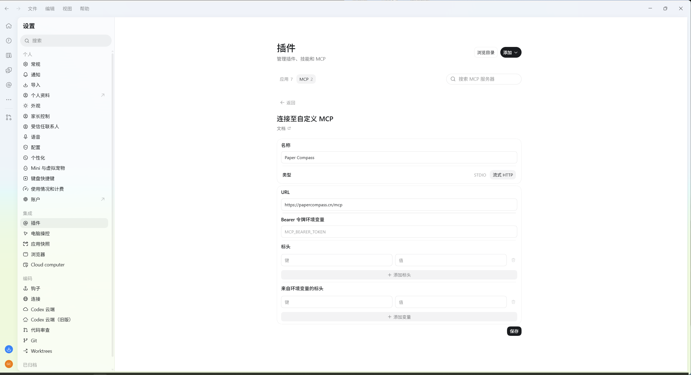

# Paper Compass MCP 用户指南

Paper Compass MCP 让 Codex、Claude Code 等 AI Agent 直接检索 Paper Compass 论文库。你可以用自然语言要求 Agent 查找最新论文、读取摘要、比较研究路线，或围绕一个方向整理文献，而不必手动在网页中逐页筛选。

## 1. MCP 是什么

MCP（Model Context Protocol）是一种让 AI Agent 调用外部数据和工具的协议。连接 Paper Compass MCP 后，Agent 可以在对话过程中查询 Paper Compass，但不会把整个论文数据库下载到你的电脑。

```text
你的问题
   ↓
Codex / Claude Code
   ↓ MCP
Paper Compass 只读检索服务
   ↓
论文题目、作者、摘要、来源、主题和原文链接
```

Paper Compass MCP 当前是公开、只读服务：

- MCP 地址：`https://papercompass.cn/mcp`
- 无需 Paper Compass 账号或 API Key；
- 不会修改、删除或更新论文数据库；
- 返回论文题录、摘要和原文链接，不直接提供 PDF 全文；
- 网站与 MCP 使用同一份论文数据。

## 2. 连接 Codex

### Codex CLI

确保本机已经安装 Codex CLI，然后在终端执行：

```bash
codex mcp add paper-compass \
  --url https://papercompass.cn/mcp
```

检查配置：

```bash
codex mcp list
```

列表中应出现 `paper-compass`，并显示为启用状态。随后重新启动 Codex 或新建一个会话。

也可以手动写入 `~/.codex/config.toml`：

```toml
[mcp_servers.paper-compass]
url = "https://papercompass.cn/mcp"
```

如果同时配置了多个论文或搜索 MCP，提问时明确说“使用 Paper Compass”，可以帮助 Agent 选择正确工具。

### Codex IDE 扩展与本地桌面工作流

Codex CLI 和 Codex IDE 扩展共用 `~/.codex/config.toml` 中的 MCP 配置。因此，只需在同一个系统用户下执行一次上述 `codex mcp add` 命令，然后重启 IDE 或新建 Codex 会话即可。

如果 IDE 中没有出现 Paper Compass，请检查：

1. IDE 扩展和终端是否使用同一个操作系统环境，例如都在 WSL 内，或都在 Windows 内；
2. 对应环境的 `~/.codex/config.toml` 中是否存在 `[mcp_servers.paper-compass]`；
3. 配置后是否已完全重启 IDE 或 Codex 会话。

> WSL 和 Windows 拥有不同的用户目录。在 WSL 里执行的 `codex mcp add` 不会自动写入 Windows 用户的 Codex 配置。

### ChatGPT 桌面端中的 Codex

如果你是在 ChatGPT 桌面端中使用 Codex，请按以下步骤添加远程 MCP：

1. 打开 **设置**， 左侧菜单栏点击 **插件**；
2. 右上角点击 **添加**，选择 **添加MCP服务器**；
3. 名称填写 `Paper Compass`，选择 **流式HTTP**，地址填写 `https://papercompass.cn/mcp`；
4. 新建对话，在工具菜单中启用 Paper Compass，再输入调研需求。



## 3. 连接 Claude

### Claude Code CLI 与 IDE

在终端执行：

```bash
claude mcp add --transport http --scope user \
  paper-compass https://papercompass.cn/mcp
```

检查配置：

```bash
claude mcp list
```

进入 Claude Code 后也可以运行：

```text
/mcp
```

确认 `paper-compass` 已连接。`--scope user` 表示在本机所有 Claude Code 项目中可用；如果只想让当前项目使用，可以去掉该参数。

### Claude Desktop 与 Claude 应用

Paper Compass 是公开的远程 MCP 服务，可通过 Claude 的自定义连接器添加，不需要下载数据库，也不需要 API Key。

Pro 或 Max 用户：

1. 在 Claude Desktop 或 Claude 网页端打开 **Customize → Connectors**；
2. 点击 **+**，选择 **Add custom connector**；
3. 名称填写 `Paper Compass`，远程 MCP URL 填写 `https://papercompass.cn/mcp`；
4. 点击 **Add** 完成添加；
5. 新建对话，点击输入框左下角的 **+ → Connectors**，启用 Paper Compass。

Team 或 Enterprise 工作区需要 Owner/Primary Owner 先在 **Organization settings → Connectors → Add → Custom → Web** 中添加；成员随后再到 **Customize → Connectors** 中连接。

> 不必为 Paper Compass 修改 `claude_desktop_config.json`。该文件主要用于由本机命令启动的 MCP；Paper Compass 已经是可公网访问的远程 HTTP 服务。

## 4. 可用工具

一般不需要手动指定工具名，Agent 会根据问题自动选择。

| 工具 | 用途 | 常用条件 |
|---|---|---|
| `search` | 搜索论文 | 关键词、主题、来源、论文类型、时间、排序、页码、每页数量 |
| `find_paper` | 按完整或近似标题查找指定论文 | 论文标题，可选来源和页码 |
| `fetch` | 获取一篇论文的详细信息 | `search` 或 `find_paper` 返回的论文 ID |
| `recent_papers` | 查看最近一段时间的新论文 | 天数、主题、来源、论文类型、页码、每页数量 |
| `list_topics` | 查看 Paper Compass 支持的研究主题 | 无 |
| `list_sources` | 查看会议、期刊和预印本来源 | 来源类型、数量 |

论文类型包括：

- `会议`
- `期刊`
- `预印本`
- `待核验来源`

排序方式包括：

- `date`：发布日期优先，适合追踪最新工作；
- `similarity`：兼容旧客户端的相关性排序参数；
- `score`：数据库已有分数，不代表与本次查询的相似度；
- `title`：按标题排序。

关键词搜索匹配论文标题。查询英文论文时，建议使用英文关键词或原始标题。追踪最新论文时，使用 `recent_papers`。

查找指定文章可以直接说：

```text
使用 Paper Compass 查找《Attention Is All You Need》。
先用 find_paper 找到候选，核对标题、作者与来源，
再用 fetch 读取最相关一篇的完整摘要，并给我原文链接。
```

`search` 和 `recent_papers` 使用分页返回结果，单页最多 50 篇。响应中的 `total`
表示当前筛选范围内参与排序的候选数量；当 `has_more` 为 `true` 时，使用同一组筛选和排序参数，并把
`page` 设置为 `next_page`，即可继续读取。Agent 默认应根据用户目标、当前结果的
相关性和覆盖度决定是否读取下一页，而不是自动遍历全部结果；只有用户明确要求
“全部”“穷尽”或完整导出时，才持续读取到 `next_page` 为 `null`。分页限制的是
单次响应大小，不是可检索论文总数。

## 5. 第一次使用

连接完成后，可以直接在 Codex、Claude Code 或 Claude Desktop 中输入：

```text
使用 Paper Compass 查看最近 30 天 AI Infra 方向的新论文，
按发布日期排序，列出最新 5 篇。每篇给出标题、作者、核心贡献和原文链接。
```

Agent 通常会执行以下过程：

1. 调用 `recent_papers` 或 `search` 获取候选论文；
2. 对重点候选调用 `fetch` 获取完整摘要和元数据；
3. 根据摘要整理核心贡献；
4. 返回可以追溯到原始论文的链接。

示例结果可能包括：

```text
1. HeteroReason: Heterogeneous FPGA-GPU Acceleration...
   方向：异构 LLM 推理基础设施
   核心贡献：在 FPGA 上运行草稿模型、GPU 上运行验证和目标模型，
   通过流水线降低推理延迟并改善能效。
   原文：https://arxiv.org/abs/2609.28717
```

实际结果取决于 Paper Compass 当时收录的数据。

## 6. 常用提问示例

### 追踪最新论文

```text
使用 Paper Compass 查找最近 7 天的大模型论文，按发布日期排序。
只保留明确研究模型架构、训练或推理方法的论文，排除泛泛提到 LLM 的文章。
```

### 只看正式会议论文

```text
使用 Paper Compass 查询 2026 年以来 AI Agent 方向的正式会议论文。
不要预印本，列出来源会议、作者、摘要要点和原文链接。
```

### 查询特定会议

```text
先用 Paper Compass 查看有哪些会议来源，
然后查找 ICLR 2026 中与推理和后训练相关的论文，返回最新 10 篇。
```

### 围绕问题做小型调研

```text
使用 Paper Compass 调研“分布式 KV Cache 如何改善大模型推理服务”。
先检索 KV cache、distributed inference、LLM serving 等关键词，
选择最相关的 8 篇论文，比较它们的问题设定、系统设计和实验结论。
所有结论都要附论文链接；摘要没有明确说明的内容不要推断为论文结论。
```

### 比较两条技术路线

```text
使用 Paper Compass 查找最近两年 speculative decoding 和
prefill-decode disaggregation 相关论文，各选择 5 篇。
比较两条路线解决的问题、硬件需求、性能指标和适用场景。
```

### 生成每周阅读清单

```text
使用 Paper Compass 制作本周 AI Infra 阅读清单：
优先选择 LLM serving、推理加速、分布式训练和 GPU 内存系统论文。
最多 10 篇，按“必读、值得浏览、备选”分组，并解释分组理由。
```

## 7. 如何获得更好的结果

- 明确要求“使用 Paper Compass”，尤其是在 Agent 同时拥有网页搜索等工具时；
- 指定时间窗口，例如最近 7 天、30 天或 2026 年以来；
- 指定论文类型，例如只看会议论文或允许预印本；
- 默认要求按日期排序，避免经典但较旧的论文挤占最新结果；
- 给出领域术语及常见英文表达，例如 `KV cache`、`LLM serving`；
- 要求 Agent 先扩大召回，再根据摘要人工式筛选，减少主题规则误收；
- 要求保留原文链接，并区分“摘要明确结论”和“Agent 推断”。

Paper Compass 的主题标签由规则自动生成，可能存在少量漏标或误标。主题适合作为候选集筛选条件，不应被当作论文质量或录用情况的证明。

## 8. 常见问题

### `codex mcp list` 中没有 Paper Compass

重新执行添加命令并检查名称：

```bash
codex mcp add paper-compass \
  --url https://papercompass.cn/mcp
codex mcp list
```

之后完全退出并重新启动 Codex。

### Agent 没有调用 Paper Compass

在问题开头明确写：

```text
使用 Paper Compass MCP，不要只依赖你已有的知识……
```

也可以要求它先调用 `list_topics` 或 `list_sources`，再开始检索。

### 浏览器打开 `/mcp` 显示 406

这是正常现象。MCP 地址不是普通网页，需要兼容 MCP Streamable HTTP 的客户端访问。普通浏览器或不带协议请求头的 `curl` 可能得到：

```text
406 Not Acceptable: Client must accept text/event-stream
```

这通常说明请求已经到达 MCP 服务，并不代表部署失败。

## 9. 相关文档

- [OpenAI 官方：在 Codex 中连接 MCP](https://developers.openai.com/learn/docs-mcp)
- [OpenAI 官方：在 ChatGPT 中添加自定义 MCP](https://developers.openai.com/plugins/deploy/connect-chatgpt)
- [Anthropic 官方：在 Claude 中添加远程自定义连接器](https://support.claude.com/en/articles/11175166-get-started-with-custom-connectors-using-remote-mcp)
- [Model Context Protocol 官方网站](https://modelcontextprotocol.io/)
